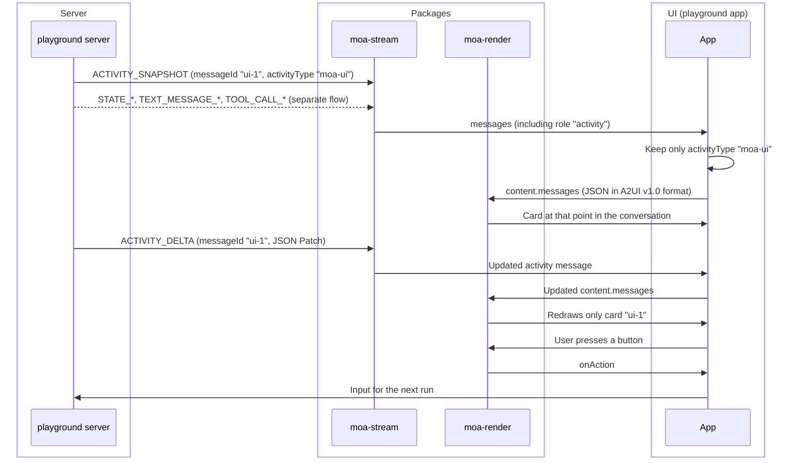

[한국어](2026-11-19-ui-spec-event.md) | English

# AG-UI event for UI specs



- An `ACTIVITY_DELTA` with the same `messageId` changes only that card.
- UI specs flow in events separate from state, so `STATE_*` never touches a card.

## Decision

An array of messages in A2UI v1.0 format is carried in `ACTIVITY_SNAPSHOT` and `ACTIVITY_DELTA`. One card is one `messageId`, and `activityType` is `"moa-ui"`. This value is a name chosen by this system, not one defined by AG-UI. No A2UI library is used: `moa-render` interprets the message format directly.

```json
{ "type": "ACTIVITY_SNAPSHOT", "messageId": "ui-1", "activityType": "moa-ui",
  "content": { "messages": [ …A2UI messages… ] } }

{ "type": "ACTIVITY_DELTA", "messageId": "ui-1", "activityType": "moa-ui",
  "patch": [{ "op": "add", "path": "/messages/-", "value": { …A2UI message… } }] }
```

`patch` is a JSON Patch (RFC 6902). Field names follow the `@ag-ui/core@1.0.4` schema.

## Alternatives

- `state.ui`: put the spec under the `ui` key of shared state with `STATE_SNAPSHOT` and `STATE_DELTA`
- Tool call: the model calls a tool such as `render_ui` and puts the spec in `TOOL_CALL_ARGS`

## Comparison with alternatives

| Aspect | **Chosen: ACTIVITY event** | Alternative: `state.ui` | Alternative: tool call |
|:---|:---|:---|:---|
| Where the screen appears | **At that point in the conversation** | One place outside the conversation | Under the message that called the tool |
| Multiple cards | **One per `messageId`** | One in one place | One per tool call |

## Reasons

- **Chosen: ACTIVITY event**
  - Pros
    - The UI spec travels in its own event and does not mix with state
    - Partial updates after drawing with `ACTIVITY_DELTA`
    - Each event carries complete JSON, so `moa-stream` never handles partial JSON
  - Cons
    - The `activityType` name (`"moa-ui"`) must be agreed with the consumer
- **Alternative: `state.ui`**
  - Pros
    - Partial updates after drawing with `STATE_DELTA`
  - Cons
    - The UI spec lives inside the agent's shared state. State holds app data (a cart, progress), so the `ui` key can collide, or a `STATE_SNAPSHOT` that replaces all of state can wipe the screen
    - Only one screen, so more cards need a separate structure inside `ui`
- **Alternative: tool call**
  - Pros
    - The UI spec travels in its own event and does not mix with state
    - The model picks a tool to show a screen
  - Cons
    - No partial updates after drawing: the tool must be called again to redraw
    - Arguments arrive as fragments of a JSON string, so partial JSON must be handled until the end

## Conclusion

The ACTIVITY event differs from `state.ui` in not mixing with state, and from tool calls in partial updates and complete JSON.

- When server code picks the screen => the server emits an ACTIVITY event directly
- When the model picks the screen with a tool => the server receives the tool call and re-emits it as an ACTIVITY event
- Either way, `moa-stream` and `moa-render` only receive ACTIVITY events
