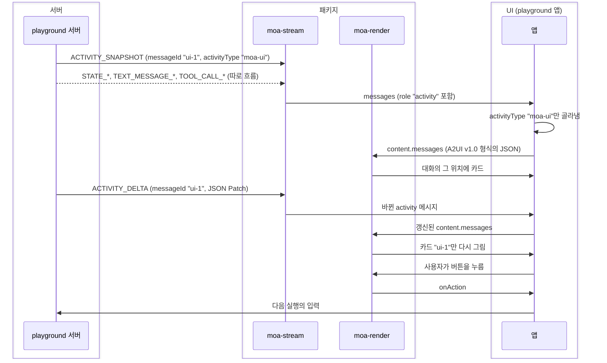

# UI 명세를 실어 보낼 AG-UI 이벤트



- 같은 `messageId`의 `ACTIVITY_DELTA`는 그 카드만 고친다.
- UI 명세는 state와 다른 이벤트로 흘러서, `STATE_*`가 카드를 건드리지 않는다.

## 결정

A2UI v1.0 형식의 메시지 배열은 `ACTIVITY_SNAPSHOT`과 `ACTIVITY_DELTA`에 담는다. 카드 하나가 `messageId` 하나이고, `activityType`은 `"moa-ui"`로 구분한다. AG-UI가 정한 값이 아니라 이 시스템이 정한 이름이다. A2UI 라이브러리는 쓰지 않고, 메시지 형식만 따라 `moa-render`가 직접 해석한다.

```json
{ "type": "ACTIVITY_SNAPSHOT", "messageId": "ui-1", "activityType": "moa-ui",
  "content": { "messages": [ …A2UI 메시지… ] } }

{ "type": "ACTIVITY_DELTA", "messageId": "ui-1", "activityType": "moa-ui",
  "patch": [{ "op": "add", "path": "/messages/-", "value": { …A2UI 메시지… } }] }
```

`patch`는 JSON Patch(RFC 6902)다. 필드 이름은 `@ag-ui/core@1.0.4` 스키마 기준이다.

## 대안

- `state.ui`: `STATE_SNAPSHOT`·`STATE_DELTA`로 공유 state의 `ui` 키에 담는 방식
- 도구 호출: 모델이 `render_ui` 같은 도구를 부르고, `TOOL_CALL_ARGS`에 명세를 담는 방식

## 대안 비교

| 비교할 점 | **선택: ACTIVITY 이벤트** | 대안: `state.ui` | 대안: 도구 호출 |
|:---|:---|:---|:---|
| 화면이 붙는 곳 | **대화 속 그 위치** | 대화 밖 한 곳 | 도구를 부른 메시지 아래 |
| 카드 여러 개 | **`messageId`마다 하나** | 한 곳에 하나 | 도구 호출마다 하나 |

## 이유

- **선택: ACTIVITY 이벤트**
  - 장점
    - UI 명세가 자기 이벤트에 따로 실려 state와 섞이지 않음
    - `ACTIVITY_DELTA`로 그린 뒤 일부만 갱신
    - 이벤트마다 완성된 JSON이 와서 `moa-stream`이 덜 완성된 JSON을 다루지 않음
  - 단점
    - 쓰는 쪽과 `activityType` 이름(`"moa-ui"`)을 맞춰야 함
- **대안: `state.ui`**
  - 장점
    - `STATE_DELTA`로 그린 뒤 일부만 갱신
  - 단점
    - UI 명세가 에이전트의 공유 state 안에 들어감. state는 앱 데이터(장바구니, 진행 상황 등)를 두는 곳이라 `ui` 키 이름이 겹치거나, state 전체를 바꾸는 `STATE_SNAPSHOT`이 화면까지 지울 수 있음
    - 화면이 한 곳뿐이라 카드를 늘리면 `ui` 안의 구조를 따로 정해야 함
- **대안: 도구 호출**
  - 장점
    - UI 명세가 자기 이벤트에 따로 실려 state와 섞이지 않음
    - 모델이 도구를 골라 화면을 띄움
  - 단점
    - 그린 뒤 일부 갱신이 없어 도구를 다시 불러 새로 그려야 함
    - 인자가 JSON 문자열 조각으로 와서, 끝날 때까지 덜 완성된 JSON을 다뤄야 함

## 결론

ACTIVITY 이벤트는 state와 섞이지 않는다는 점이 `state.ui`와 다르고, 일부 갱신과 완성된 JSON이 도구 호출과 다르다. 

- 서버 코드가 화면을 고를 때 => 서버가 ACTIVITY 이벤트를 바로 내보냄
- 모델이 도구로 화면을 고를 때 => 서버가 도구 호출을 받아 ACTIVITY 이벤트로 바꿔 내보냄
- 어느 쪽이든 `moa-stream`·`moa-render`가 받는 것은 ACTIVITY 이벤트!
