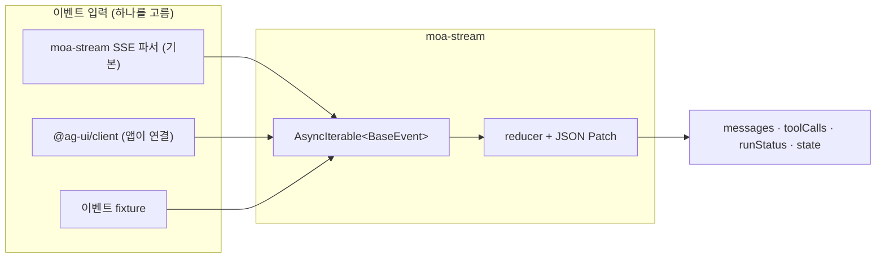

# moa-stream의 AG-UI 의존 범위

## 결정

`moa-stream`은 `@ag-ui/core`의 타입과 `EventType`만 쓰고, 나머지는 직접 만든다.

- SSE 파싱
- JSON Patch 적용 (`add`, `replace`)
- 이벤트를 state로 바꾸는 reducer
- 연결 중단과 오류 처리

hook은 이벤트 스트림 `AsyncIterable<BaseEvent>`를 입력으로 받는다. 기본 입력은 `moa-stream`의 SSE 파서가 만들고, `@ag-ui/client`나 fixture를 쓰려는 앱은 자기 스트림을 넣는다.

JSON Patch는 신뢰할 수 없는 입력이다. 경로에 `__proto__`, `constructor`, `prototype`이 있거나 지원하지 않는 op가 오면 적용하지 않고 오류로 알린다. `@ag-ui/core`의 peer dependency인 zod를 어떻게 걸지는 DOC-7에서 정한다.

## 대안

- `@ag-ui/client` 통째로 쓰기: `HttpAgent`가 연결, 파싱, 검증, JSON Patch를 맡고 `moa-stream`은 hook으로 감싸기만 하는 방식

## 대안 비교

| 비교할 점 | **선택: core 타입 + 직접 구현** | 대안: `@ag-ui/client` |
|:---|:---|:---|
| 더해지는 크기 (gzip) | **`EventType` 0.4KB와 직접 만든 코드** | `HttpAgent`만 약 99.7KB |
| 함께 설치되는 의존 | **`@ag-ui/core` (peer: zod)** | `@ag-ui/core`, rxjs, protobuf, fast-json-patch |
| 직접 만들 코드 | **SSE 파싱, JSON Patch, reducer, 중단·오류 처리** | hook 래핑, rxjs 구독 관리 |
| 공식 에이전트 연동 (`AbstractAgent` 상속) | **앱이 스트림으로 바꿔 넣음** | 그대로 꽂음 |

## 이유

- **선택: core 타입 + 직접 구현**
  - 장점
    - DOC-5의 기준인 의존·번들 최소화에 맞음
    - 쓰는 이벤트만 처리하고, reducer가 순수 함수라 이벤트 배열 → state로 테스트
    - 입력을 `AsyncIterable<BaseEvent>`로 열어 두어 `@ag-ui/client`가 필요한 앱도 연결 가능
  - 단점
    - AG-UI에 새 이벤트가 생기면 reducer에 직접 추가
    - 기준 구현과 해석이 어긋날 수 있어 fixture 테스트로 확인
    - JSON Patch 경로 검증을 직접 책임짐
- **대안: `@ag-ui/client`**
  - 장점
    - 연결·파싱·검증·JSON Patch를 기준 구현에 맡김
    - 사양 변경을 버전 올리기로 따라감
  - 단점
    - `HttpAgent`만 약 99.7KB로, `moa` 전체 JS 예산(40KB)의 두 배가 넘음
    - rxjs, protobuf 등 의존이 많아 버전 고정과 공급망 관리 대상이 늘어남
    - rxjs Observable을 React hook으로 감쌀 때 구독·해제를 따로 관리

## 결론

실행 중 성능은 두 방식이 거의 같고, 차이는 첫 로딩 크기와 직접 만들 코드 양이다.

- `@ag-ui/client`의 이점인 공식 연동 => 입력을 스트림으로 열어 두어 앱 쪽에서 살림
- DOC-5의 "`moa-stream`은 `@ag-ui/client`에 의존한다" => DOC-7에서 이 결정에 맞게 고침
