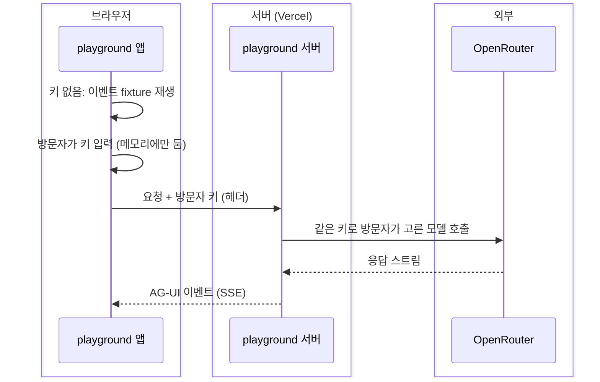

# playground 공개 방식과 모델 키

- 서버는 키를 저장하거나 기록하지 않고 OpenRouter로 넘기기만 한다.
- 키가 없으면 서버를 부르지 않는다.

## 결정

playground는 Vercel에 공개하고, 모델 호출에는 방문자 키를 쓴다. 우리 키는 두지 않는다.

- 첫 화면은 이벤트 fixture 재생으로, 키 없이 바로 체험
- 방문자가 OpenRouter 키를 넣으면 실제 모델 사용
- 키는 브라우저 메모리에만 두고 `localStorage`·`sessionStorage`에 저장하지 않음
- 키는 요청마다 헤더로 playground 서버에 보내고, 서버는 저장·기록 없이 OpenRouter로만 전달
- 어떤 모델을 쓸지는 DOC-12에서 정함
- 서버가 부르는 외부 주소는 OpenRouter 하나로 고정

공개 배포는 SEC-4를 통과한 뒤에 한다. 공개 조건은 SEC-3에서 대책으로 정했다.

- `moa-render`가 링크·이미지 URL 스킴을 허용 목록으로 거름. 키를 다루는 화면이라 XSS가 곧 키 유출
- 서버가 `onAction` 입력을 검증
- 서버 로그와 오류 리포트에 요청 헤더가 남지 않음
- 화면에 "입력이 모델 제공자에게 기록될 수 있음" 안내
- Vercel Firewall로 IP당 요청 수 제한

## 대안

- 로컬 전용: 공개하지 않고, 각자 레포를 받아 자기 키로 실행하는 방식
- 우리 키로 공개: 서버 환경 변수에 OpenRouter 키를 두고 모든 방문자가 같이 쓰는 방식
- 브라우저 직접 호출: 방문자 키로 브라우저에서 OpenRouter를 바로 부르는 방식

## 대안 비교

| 비교할 점 | **선택: 공개 + 방문자 키 (서버 경유)** | 대안: 로컬 전용 | 대안: 우리 키로 공개 | 대안: 브라우저 직접 호출 |
|:---|:---|:---|:---|:---|
| 처음 써보는 방법 | **링크를 열고 fixture 재생** | 레포를 받아 실행 | 링크를 열고 실제 모델 | 링크를 열고 fixture 재생 |
| 무료 한도 | **방문자마다 따로** | 각자 따로 | 모든 방문자가 하나를 나눠 씀 | 방문자마다 따로 |
| 키가 지나가는 곳 | **브라우저 → 우리 서버 → OpenRouter** | 각자 로컬 | 우리 서버 → OpenRouter | 브라우저 → OpenRouter |
| 이벤트가 오는 길 | **서버에서 SSE** | 서버에서 SSE | 서버에서 SSE | 브라우저 안에서 생성 |

## 이유

- **선택: 공개 + 방문자 키 (서버 경유)**
  - 장점
    - 링크 하나로 누구나 fixture를 체험
    - 우리 키가 없어 키 노출과 유료 호출 위험이 없음
    - 한도와 비용이 방문자 몫
    - 서버 → SSE → `moa-stream`의 실제 경로를 그대로 시연
  - 단점
    - 방문자가 "서버가 키를 저장하지 않는다"를 믿어야 함
    - `moa-render`의 XSS가 곧 키 유출이라 URL 허용 목록이 필수
    - 키가 없는 방문자는 fixture까지만 봄
- **대안: 로컬 전용**
  - 장점
    - 공개 운영과 남용 대응이 필요 없음
  - 단점
    - 레포를 받아 실행해야 해서 보여주기 어려움
- **대안: 우리 키로 공개**
  - 장점
    - 방문자가 키 없이 실제 모델을 체험
  - 단점
    - 모르는 사람이 하루 무료 한도를 다 써버림
    - 키가 새거나 모델 이름을 조작하면 유료 호출이 생길 수 있음
- **대안: 브라우저 직접 호출**
  - 장점
    - 키가 우리 서버를 지나가지 않음
  - 단점
    - 에이전트 로직이 브라우저로 옮겨 와 서버 → SSE 경로를 시연하지 못함
    - XSS로 키를 뺏길 위험은 그대로

## 결론

방문자 키를 서버로 보내는 방식은 우리 키 문제와 한도 문제를 없애면서 실제 SSE 경로를 지킨다. 남는 위험은 XSS와 키 기록이고, 둘 다 SEC-3에서 대책을 정했다.

- 공개 => Vercel, 첫 화면은 fixture 재생
- 모델 키 => 방문자 키, 브라우저 메모리에만, 서버는 전달만
- 배포 시점 => SEC-4 통과 후
