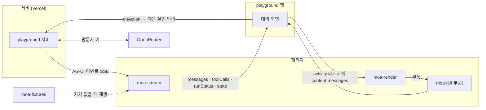

# 에이전트 연결 패키지 설계

DOC-5의 패키지 경계를 따르고, 이 문서는 세 패키지의 내용을 정한다. 이 작업 중 고른 결정은 따로 두고 여기서는 결론만 쓴다.

- DOC-9: UI 명세는 `ACTIVITY_SNAPSHOT`·`ACTIVITY_DELTA`에 `activityType: "moa-ui"`로 담음
- DOC-10: `moa-stream`은 `@ag-ui/core` 타입만 쓰고 나머지는 직접 구현, 입력은 `AsyncIterable<BaseEvent>`
- DOC-11: playground는 Vercel에 공개하고 방문자 키를 서버 경유로 사용
- DOC-12: 방문자가 모델을 고름. 추천 모델 두 개와 직접 입력, 무료 모델은 추천하지 않음
- DOC-13: `render_ui` 도구 인자는 surface 하나, 서버가 A2UI 메시지로 감쌈

## 전체 구조



- `moa-stream`과 `moa-render`는 서로 모름. 둘을 잇는 일은 앱 몫
- 실선은 실제 모델을 쓸 때, 점선은 fixture를 재생할 때의 길

## moa-stream

### 입력

hook은 `AsyncIterable<BaseEvent>`를 받는다.

- `moa-stream`이 제공하는 것: `sseEvents(url, init)`. `fetch`로 POST하고 `text/event-stream` 응답을 이벤트로 바꿈. `init.signal`로 중단
- 앱이 직접 만들어 넣는 것
  - 이벤트 fixture: private 패키지 `moa-fixtures`의 `replay(events, delayMs)`. 스토리와 playground가 같이 씀
  - `@ag-ui/client`: `Observable`을 `AsyncIterable`로 바꿔 넣음

### 상태

```ts
type StreamState = {
  runStatus: "idle" | "running" | "finished" | "error";
  messages: Message[];          // @ag-ui/core Message. role "activity" 포함
  toolCalls: Record<string, ToolCallState>;
  state: unknown;               // STATE_SNAPSHOT·STATE_DELTA로 만든 공유 state
  error?: { message: string; code?: string };
};

type ToolCallState = {
  id: string;
  name: string;
  args: string;                 // TOOL_CALL_ARGS 조각을 이어 붙인 원문 문자열
  result?: string;              // TOOL_CALL_RESULT.content. 파트 배열이면 text 파트만 이어 붙임
  status: "running" | "finished" | "error";
};
```

상태 이름과 필드는 moa `RunStatus`·`ToolCallCard` props와 같게 둬서 그대로 넘긴다. `ToolCallCard`의 `pending`은 쓰지 않는다. `TOOL_CALL_START`가 오면 바로 `running`이다.

### 이벤트 처리

| 이벤트 | 상태 변화 |
|:---|:---|
| `RUN_STARTED` | `runStatus`를 `running`으로, `error` 비움 |
| `RUN_FINISHED` | `runStatus`를 `finished`로 |
| `RUN_ERROR` | `runStatus`를 `error`로, `error`에 메시지. 끝나지 않은 도구 호출은 `status`를 `error`로 |
| `TEXT_MESSAGE_START` · `CONTENT` · `END` | `messageId`로 메시지를 만들고 `delta`를 이어 붙임 |
| `TOOL_CALL_START` · `ARGS` · `END` | `toolCalls`에 `running`으로 추가하고 `args`를 이어 붙임 |
| `TOOL_CALL_RESULT` | 해당 도구 호출의 `result`를 채우고 `status`를 `finished`로 |
| `STATE_SNAPSHOT` · `STATE_DELTA` | `state` 교체, JSON Patch 적용 |
| `ACTIVITY_SNAPSHOT` | `messageId`의 activity 메시지를 만들거나 `content`를 교체. `replace: false`이고 이미 있으면 무시 |
| `ACTIVITY_DELTA` | 해당 activity 메시지의 `content`에 JSON Patch 적용 |

- 그 밖의 이벤트(`MESSAGES_SNAPSHOT`, `STEP_*`, `REASONING_*`, `SUBAGENT_*`, `*_CHUNK`, `RAW`, `CUSTOM`)는 무시. 오류로 보지 않음
- 없는 `messageId`·`toolCallId`를 가리키는 이벤트도 무시
- reducer는 순수 함수

### JSON Patch

- 지원 op는 `add`, `replace`
- 경로는 RFC 6901 JSON Pointer. 배열은 숫자 인덱스와 끝에 붙이는 `-`(`add`만) 지원
- 그 밖의 op나 `__proto__`, `constructor`, `prototype`이 든 경로가 있으면 패치 전체를 적용하지 않음
- 적용하지 않은 패치는 `error`에 남기고, `runStatus`와 화면은 이전 상태 유지

### API

```ts
function reduceEvent(state: StreamState, event: BaseEvent): StreamState;
function sseEvents(url: string, init?: RequestInit): AsyncIterable<BaseEvent>;
function useAgentStream(): {
  state: StreamState;
  run(source: AsyncIterable<BaseEvent>, newMessages?: Message[]): Promise<void>;
  abort(): void;
};
```

- `run`: `newMessages`(보통 사용자 메시지)를 `messages` 끝에 붙인 뒤 이벤트를 읽음. 서버는 사용자 메시지를 이벤트로 돌려주지 않아서, 대화 화면과 다음 실행 입력에 사용자 발화를 남기는 길은 이것뿐
- 새 실행마다 `runStatus`·`error`·`toolCalls`만 초기화하고 `messages`는 이어 감. 실행 중에 다시 부르면 이전 실행을 중단
- `abort`: 진행 중인 이터레이터를 `return()`으로 닫고 `runStatus`를 `idle`로

### 의존

- `dependencies`: `@ag-ui/core@1.0.4`. zod는 이 패키지의 선택적 peer dependency라 설치 경고가 없고, `moa-stream`도 zod를 쓰지 않음
- `peerDependencies`: `react`
- `moa`에는 의존하지 않음

## moa-render

A2UI 라이브러리는 쓰지 않고, A2UI v1.0 메시지 중 아래 범위만 직접 해석한다. 필드 이름은 A2UI v1.0 스키마(`@a2ui/web_core@0.15.0`의 `v1_0`) 기준이다.

### 메시지

| 메시지 | 지원 |
|:---|:---|
| `createSurface` | `surfaceId`, `components`, `dataModel`. `catalogId`·`sendDataModel`·`metadata`는 무시 |
| `updateComponents` | `id`가 같은 부품을 교체하고, 없으면 추가 |
| `updateDataModel` | `path` 위치에 `value`를 넣음. `path`가 없으면 데이터 모델 전체 교체 |
| `deleteSurface` | 해당 surface 제거 |
| `callRendererFunction` 등 함수 호출 | 지원하지 않음. 무시하고 `onError`로 알림 |

`version`이 `"1.0"`이 아닌 메시지도 무시하고 `onError`로 알린다.

### 부품

부품은 `{ id, component, ...props }` 모양이고, 트리의 뿌리는 `id`가 `"root"`인 부품이다.

- 지원 부품: Text, Image, Icon, Row, Column, List, Card, Divider, Button, TextField, CheckBox, ChoicePicker, Slider, DateTimeInput, Modal, Tabs
- 부품마다 A2UI catalog에 있는 prop만 허용 목록으로 골라 전달. 목록에 없는 키(`props`, `style`, `className`, `dangerouslySetInnerHTML`, `on`으로 시작하는 키 등)는 버림. moa 부품 중 Button은 나머지 prop을 DOM에 펼쳐 넣어서, 허용 목록 없이 넘기면 명세가 DOM 속성을 정할 수 있음
- 허용한 prop은 이름이 moa와 같아 그대로 전달(DOC-5). 기본값이 다른 곳만 catalog 기본값을 넣음. 예: Image `fit`은 `"fill"`
- 이름이나 모양을 바꿔 넘기는 prop은 아래 표와 같음
- Video, AudioPlayer, 모르는 `component`, 없는 id 참조는 그 자리만 비우고 `onError`로 알림. 형제 부품은 그대로 그림
- 트리 깊이가 상한을 넘으면 그 아래를 비움. id 참조 순환도 이 상한에서 멈춤

| A2UI | moa | 바꾸는 방법 |
|:---|:---|:---|
| Row·Column·List `children` | `children` | id 배열을 React 요소로 |
| Card·Button `child` | `children` | id를 React 요소로 |
| Modal `trigger` · `content` | `trigger` · `children` | id를 React 요소로. moa가 필수로 받는 `title`은 A2UI에 없어 빈 문자열 |
| Tabs `tabs[].child` | `tabs[].child` | id를 React 요소로 |
| Button `action` | `onClick` | 누르면 `onAction` 호출 |
| 입력 부품 `value` | `value` · `onChange` | path면 `onChange`에서 그 path에 씀 |
| 입력 부품 `label` | `label` | A2UI에서는 선택, moa에서는 필수라 없으면 빈 문자열 |

입력 부품은 TextField, CheckBox, ChoicePicker, Slider, DateTimeInput이다.

### 값과 바인딩

- 값은 리터럴이거나 `{ "path": "/a/b" }`(또는 `"@path"`). path는 JSON Pointer로 데이터 모델을 읽음
- 입력 부품의 `value`가 path면 양방향. 사용자가 바꾼 값은 그 path에 씀
- 함수 호출 값(`call`, `@call`)은 빈 값으로 그림
- `checks`와 `children`의 템플릿 형식(`{ componentId, path }`)은 지원하지 않음

### action

Button의 `action.event`만 지원한다. 누르면 `onAction`을 부른다.

```ts
type MoaAction = {
  name: string;                 // action.event.name
  surfaceId: string;
  sourceComponentId: string;
  timestamp: string;            // ISO 8601
  context: Record<string, unknown>; // action.event.context의 path를 읽어 채운 값
  userMessage?: string;
};
```

모양은 A2UI v1.0 `action` 메시지와 같다. `action.functionCall`은 지원하지 않는다.

### 갱신

`messages`가 바뀔 때마다 처음부터 다시 계산한다. 카드 하나의 메시지는 몇 개뿐이라 비용이 작다. 사용자가 입력한 값은 path → 값 목록으로 따로 들고 있다가 계산한 데이터 모델 위에 덮는다. 그래서 사용자가 한 번 바꾼 path는 서버가 같은 path에 새 값을 보내도 사용자 값이 보인다.

### API

```ts
// @dusunax/moa-render/core: React 없음
function toSurfaces(messages: A2uiMessage[]): { surfaces: Surfaces; errors: MoaRenderError[] };
function checkSurfaces(surfaces: Surfaces): MoaRenderError[]; // root, 없는 id 참조, 깊이·부품 수 상한

// @dusunax/moa-render
function MoaSurfaces(props: {
  messages: A2uiMessage[];
  onAction?: (action: MoaAction) => void;
  onError?: (error: MoaRenderError) => void;
  isAllowedUrl?: (url: string, kind: "image" | "link") => boolean;
  allowSensitive?: boolean;     // 기본 false
}): ReactNode;
```

- `core` 하위 경로는 React를 import하지 않음. playground 서버가 `render_ui` 검증에 그대로 써서, 서버와 렌더러가 같은 판정을 내림
- `toSurfaces`·`checkSurfaces`는 순수 함수. 테스트는 메시지 → surface 상태, 메시지 → DOM으로 나눔
- surface가 여럿이면 만든 순서대로 그림
- `messages`가 배열이 아니면 아무것도 그리지 않고 `onError`로 알림. activity의 `content`는 형식이 정해지지 않은 객체라 앱이 넘긴 값을 믿지 않음

### 보안

명세는 모델이 만들고, 공개 playground에서는 누구나 프롬프트로 조종할 수 있다. 방문자 키를 다루는 화면이라 XSS는 곧 키 유출이다(DOC-11).

- Image: `https:`이고 `isAllowedUrl(url, "image")`가 `true`일 때만 그림. 기본값은 모두 `false`라 외부 이미지를 불러오지 않음. 이미지 요청만으로 방문자 IP와 화면을 본 시점이 이미지 서버에 전달되기 때문(SEC-1.3)
- Text 링크
  - 스킴은 moa Text가 이미 `http:`, `https:`, `mailto:`만 링크로 만듦
  - `moa-render`는 Text에 넘기기 전에 링크 글자 뒤에 실제 도메인을 붙임: `[문서](https://evil.example/x)` → `[문서 (evil.example)](…)`. 보이는 글자와 실제 주소가 달라도 사용자가 알 수 있음(SEC-2.3)
  - `isAllowedUrl(url, "link")`가 `false`면 링크 대신 같은 글자를 평문으로 둠. 기본값은 모두 `true`
- 민감 부품: `allowSensitive`가 `false`면 `obscured` TextField와 Modal을 그리지 않고 `onError`로 알림. 비밀번호 입력란이나 창을 띄워 정보를 받아 가는 피싱을 막기 위해서(SEC-1.7)
- 문자열은 React 텍스트로만 넣고 `dangerouslySetInnerHTML`은 쓰지 않음
- 명세의 prop은 "부품"의 허용 목록에 있는 것만 넘김(SEC-3.9)
- 데이터 모델 path에도 JSON Patch와 같은 경로 차단(`__proto__`, `constructor`, `prototype`)
- 부품 수와 트리 깊이에 상한. 값은 DOC-8에서 정함

### 의존

- `peerDependencies`: `@dusunax/moa`, `react`, `react-dom`. 앱도 moa를 직접 쓰므로, dependency로 걸면 버전이 다를 때 부품과 CSS가 두 벌 깔림
- 앱은 `@dusunax/moa/styles.css`를 직접 불러옴
- A2UI 타입은 직접 선언하고 `@a2ui/*`에는 의존하지 않음
- 공개 경로는 `.`(`MoaSurfaces`)과 `./core`(`toSurfaces`, `checkSurfaces`, 타입) 두 개

## playground

`apps/playground`에 두는 private 패키지이고, Vercel 프로젝트 하나로 공개한다.

### 구성

- 앱: Vite + React. `moa`, `moa-stream`, `moa-render`를 workspace로 사용
- 서버: `apps/playground/api/agent.ts` Vercel Function. 요청 사이에 상태를 두지 않음. 로컬에서는 같은 핸들러를 Vite 개발 서버에 붙임
- fixture: private 패키지 `packages/moa-fixtures`(`@dusunax/moa-fixtures`). 이벤트 JSON과 `replay` 도우미를 두고 `moa-stream` 테스트, 스토리, playground가 같이 씀. 배포하지 않음

### 서버

입력은 AG-UI `RunAgentInput`이고, 응답은 AG-UI 이벤트를 SSE로 보낸다.

- 방문자 키는 `Authorization` 헤더로 받음. URL에 넣지 않고, 저장·기록하지 않고 OpenRouter 호출에만 사용. Vercel 로그는 쿼리 문자열을 기록함
- 모델은 `forwardedProps.model`로 받음. 없으면 기본 추천 모델 `deepseek/deepseek-v4-flash`. 이름은 형식만 검증(`[a-z0-9._~/-]`와 `:` 꼬리표, 100자 이하)하고 어긋나면 400. 무료 모델은 추천하지 않지만 직접 입력으로는 쓸 수 있음(DOC-12)
- 모델에게 `render_ui` 도구를 줌. 도구 인자는 surface 하나(`{ surfaceId, components, dataModel? }`)이고, 서버가 `{ version: "1.0", createSurface: 인자 }`로 감싸 A2UI 메시지 배열을 만듦(DOC-13)
- 서버는 인자를 끝까지 받은 뒤 `@dusunax/moa-render/core`의 `toSurfaces`·`checkSurfaces`로 형식과 참조한 id가 모두 있는지까지 검증하고 `ACTIVITY_SNAPSHOT`으로 내보냄(DOC-9 결론). 검증에 실패하면 화면 대신 오류 텍스트 메시지. 모델이 도구를 부르지 않으면 그 모델이 화면 그리기를 잘 못한다는 안내를 붙임
- 시스템 프롬프트에 `render_ui` 형식 규칙과 완성된 예시 하나를 넣음(DOC-13)
- 도구 인자 스키마는 느슨하게 두고 엄격 스키마(`strict: true`)는 쓰지 않음(DOC-13)
- `render_ui`의 `TOOL_CALL_*` 이벤트는 클라이언트로 보내지 않음. 화면은 activity 메시지 하나로만 나타남
- 요청의 `messages`를 모델에 넘기기 전에 role `activity` 메시지를 "이 화면을 보여 줌: <surface>" 내용의 assistant 텍스트로 바꿈. surface는 모델이 쓰는 형식과 같게 `createSurface` 안쪽만 보여 줌. OpenRouter는 `activity` role을 모르고, 이렇게 해야 모델이 자기가 보여 준 화면을 앎
- 화면을 고칠 때도 새 `ACTIVITY_SNAPSHOT`. `ACTIVITY_DELTA`는 보내지 않고, delta 처리는 fixture와 테스트로 확인
- 호출하는 외부 주소는 OpenRouter 하나

### 앱

- 첫 화면은 fixture 재생. 키를 넣으면 실제 모델로 전환
- 모델 선택: 추천 모델 두 개를 버튼으로 두고 요청당 대략 비용과 특징(빠름, 정확함)을 함께 보여 줌. 그 아래에 모델 이름 직접 입력 칸. 고른 모델은 `forwardedProps.model`로 보냄
- 안내 문구
  - 402(크레딧 없음): "계정에 크레딧이 필요해요"
  - OpenRouter 429(`limit_source`가 공용 용량): "이 모델이 붐벼요, 다른 모델을 골라 보세요"
  - 우리 Firewall 429(`/api/agent` 요청 수 제한): "요청이 너무 많아요, 잠시 후 다시"
  - 도구 미호출: "이 모델은 화면 그리기를 잘 못해요"
  - 서버는 두 429를 구분할 수 있게 OpenRouter 429를 `RUN_ERROR`의 `code`로 넘김. Firewall 429는 HTTP 응답 자체라 `sseEvents`가 HTTP 오류로 바꿈
- 키는 React 상태에만 둠. 새로고침하면 사라짐
- role `activity`이고 `activityType`이 `"moa-ui"`인 메시지는 `MoaSurfaces`로, 나머지는 moa `MessageBubble`·`StreamingText`·`ToolCallCard`로 그림
- `MoaSurfaces`의 `isAllowedUrl`·`allowSensitive`는 기본값 그대로 둠. 외부 이미지는 그리지 않고, 민감 부품도 그리지 않음
- 화면 위에 "입력이 모델 제공자에게 기록될 수 있음" 안내

### action 왕복

- 앱은 `onAction`으로 받은 `MoaAction`을 그 카드의 `messageId`와 함께 다음 실행의 `RunAgentInput.forwardedProps.moaAction`에 `{ messageId, action }`으로 담음. 모델이 카드마다 같은 `surfaceId`를 쓸 수 있어서 카드는 `messageId`로 구분
- 서버는 모양과 크기만 검증하고, 사용자가 입력한 텍스트와 같은 신뢰 수준으로 모델에 넘김. action은 사용자 입력보다 권한이 많지 않아 surface 기록이나 action 이름 허용 목록을 서버에 두지 않음(SEC-3.5)

### 배포

- SEC-4 통과 후 공개
- Vercel Firewall로 `/api/agent`에 IP당 60초 20회 제한
- 서버 로그와 오류 리포트에 요청 헤더를 남기지 않음
- pnpm은 `packageManager` 필드와 corepack으로 12.18.0에 고정

## 크기 예산

size-limit 리포트 모드(경고만)로 잰다. react와 `moa`는 제외한다.

| 대상 | 예산 (gzip) |
|---|---|
| `moa-stream` 전체 | 4KB |
| `moa-render` 전체 | 6KB |

## 테스트

- `moa-stream`: fixture 이벤트 배열 → `StreamState`. 지원하지 않는 op, 차단 경로, 끊긴 SSE를 따로 확인
- `moa-render`: 메시지 → surface 상태, 메시지 → DOM. 모르는 부품, 없는 id, 순환 참조, 허용하지 않은 Image, 링크 도메인 표시, 민감 부품 차단을 따로 확인
- 스토리: fixture를 재생해 대화 화면 전체를 보여 주는 스토리
- playground 서버: OpenRouter 응답을 fixture로 대신한 핸들러 테스트. 키가 로그에 남지 않는지 확인

## 범위 밖

- A2UI 함수 호출, `checks`, `children` 템플릿, `sendDataModel`
- Video, AudioPlayer
- `MESSAGES_SNAPSHOT`, `*_CHUNK`, `REASONING_*`, `SUBAGENT_*` 이벤트
- playground 서버의 `ACTIVITY_DELTA` 생성
- protobuf 전송
- 공개 패키지의 fixture 재생·`@ag-ui/client` 연결 도우미. 재생 도우미는 private `moa-fixtures`에만 둠
